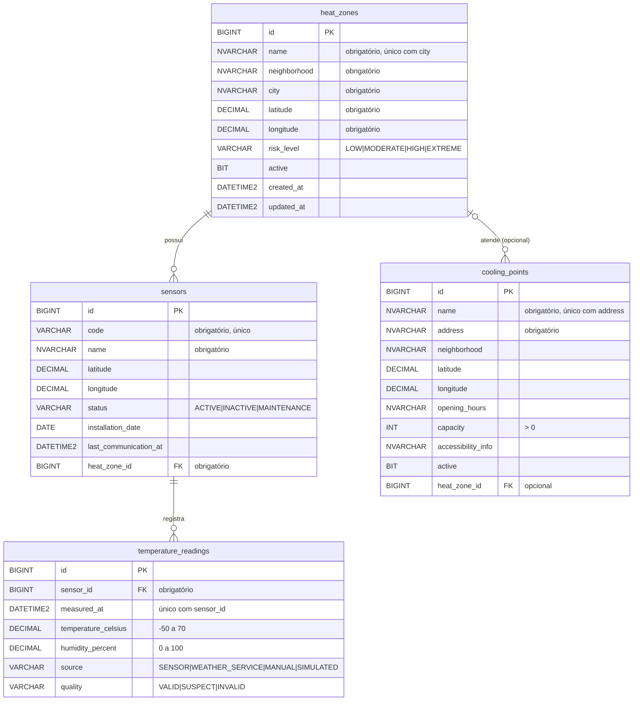

# Brisa Cidadã API

API REST da solução CitizenTech **Brisa Cidadã**, que ajuda a prevenir riscos de calor extremo nas cidades.
A API reúne leituras de sensores (temperatura e umidade) para identificar zonas de maior exposição,
cadastra pontos públicos de resfriamento e gera **alertas demonstrativos** com orientações preventivas.

> O alerta é apenas calculado e retornado pela API. **Nenhuma notificação real** (SMS, WhatsApp, e-mail, push)
> é enviada, e o resultado não substitui comunicados oficiais da Defesa Civil ou de órgãos de saúde.

## Sumário

- [Escopo](#escopo)
- [Arquitetura](#arquitetura)
- [Modelo de dados](#modelo-de-dados)
- [Tecnologias e requisitos](#tecnologias-e-requisitos)
- [Variáveis de ambiente](#variáveis-de-ambiente)
- [Execução local](#execução-local)
- [Documentação (Swagger) e rotas](#documentação-swagger-e-rotas)
- [Exemplos de chamadas](#exemplos-de-chamadas)
- [Testes](#testes)
- [Docker Hub e GitHub Actions](#docker-hub-e-github-actions)
- [Implantação no Azure](#implantação-no-azure)
- [Limitações e dados demonstrativos](#limitações-e-dados-demonstrativos)
- [Pendências externas](#pendências-externas)

## Escopo

- CRUD completo de quatro entidades: zonas de calor, sensores, leituras de temperatura e pontos de resfriamento.
- Consulta de alerta de calor por zona (`GET /api/v1/heat-zones/{id}/heat-alert`) com regras determinísticas configuráveis.
- Documentação OpenAPI/Swagger, health check, migrações versionadas (Flyway), Docker e pipeline de CI/CD.
- Fora do escopo: autenticação, integrações externas (meteorologia, mensageria) e envio de notificações.

## Arquitetura

Arquitetura em camadas (pacote base `br.com.brisacidada.api`):

| Pacote | Responsabilidade |
|---|---|
| `controller` | Rotas HTTP, validação de entrada (`@Valid`), códigos HTTP e cabeçalho `Location` |
| `service` | Regras de negócio, transações, verificação de referências e conflitos, cálculo do alerta |
| `repository` | Persistência com Spring Data JPA |
| `entity` | Entidades JPA e enums de domínio |
| `dto/request`, `dto/response` | Contratos de entrada e saída (entidades nunca são expostas) |
| `mapper` | Conversão DTO ↔ entidade com ModelMapper (configurado em `config/ModelMapperConfig`) |
| `exception` | Exceções de domínio e `GlobalExceptionHandler` (respostas de erro padronizadas, sem stack trace) |
| `config` | ModelMapper, OpenAPI, `Clock` e propriedades do alerta |

Controllers só falam com services; services usam repositories e mappers. Relacionamentos são resolvidos pelos
services a partir dos IDs recebidos (com 404 se não existirem); o ModelMapper é configurado para ignorar esses campos.

## Modelo de dados



Todas as tabelas têm `created_at`/`updated_at` preenchidos pela aplicação (não aceitos como entrada).
O esquema é criado por [V1__create_tables.sql](src/main/resources/db/migration/V1__create_tables.sql), com chaves,
`UNIQUE`, `CHECK`, `FOREIGN KEY` e índices. O Hibernate não altera o esquema (`ddl-auto=none`).

`cooling_points.heat_zone_id` é opcional porque um ponto de resfriamento pode atender regiões ainda não mapeadas
como zona de calor.

### Regras de negócio

- Nomes de zona são únicos por cidade; códigos de sensor são únicos; pontos são únicos por nome e endereço;
  só pode existir uma leitura por sensor em um mesmo instante. Conflitos retornam **409**, com verificação
  no service (sem diferenciar maiúsculas/minúsculas) e restrições `UNIQUE` no banco.
- Referências inexistentes (`heatZoneId`, `sensorId`) retornam **404**.
- Exclusão bloqueada (**409**) quando há dependentes: zona com sensores/pontos vinculados, sensor com leituras.
- Ao registrar uma leitura mais recente, `lastCommunicationAt` do sensor é atualizado.
- `active` assume `true` e `quality` assume `VALID` quando omitidos.

### Alerta de calor (demonstrativo)

`GET /api/v1/heat-zones/{id}/heat-alert`:

1. Seleciona as leituras dos sensores da zona nas últimas `brisa.heat-alert.lookback-hours` horas (padrão 3),
   ignorando leituras `INVALID`.
2. Calcula o índice de calor (sensação térmica) de cada leitura pela regressão de Rothfusz (NWS/NOAA).
3. Classifica o maior índice pelos limiares configuráveis (°C): `ATTENTION` ≥ 27, `ALERT` ≥ 32, `DANGER` ≥ 41,
   `EXTREME` ≥ 54; abaixo disso `NORMAL`; sem leituras, `INSUFFICIENT_DATA`.
4. Retorna estatísticas, recomendações preventivas, pontos de resfriamento ativos da zona, a flag
   `includesSimulatedData` (se alguma leitura tem origem `SIMULATED`) e um aviso de que nada é enviado.

Nenhuma entidade adicional é persistida para o alerta.

## Tecnologias e requisitos

- Java 17 (LTS), Spring Boot 4.0.9 (Web MVC, Validation, Data JPA, Actuator, Flyway)
- Microsoft SQL Server (driver `mssql-jdbc`), Flyway (`flyway-sqlserver`)
- springdoc-openapi 3.0.3 (Swagger UI), ModelMapper 3.2.8, Lombok
- Maven Wrapper (Maven 3.9.12)
- Testes: JUnit 5, Mockito, MockMvc, H2 (modo SQL Server), Testcontainers (SQL Server)
- Para Docker: Docker Engine/Desktop com Compose v2

## Variáveis de ambiente

| Variável | Obrigatória | Descrição |
|---|---|---|
| `DB_URL` | sim | URL JDBC do SQL Server (exemplos abaixo) |
| `DB_USERNAME` | sim | Usuário do banco |
| `DB_PASSWORD` | sim | Senha do banco (nunca versionar) |
| `PORT` | não | Porta HTTP (padrão `8080`) |
| `SPRING_PROFILES_ACTIVE` | não | `dev` carrega dados fictícios de demonstração; omita em produção |
| `DB_POOL_SIZE` | não | Tamanho do pool Hikari (padrão `10`) |
| `HEAT_ALERT_LOOKBACK_HOURS` | não | Janela do alerta em horas (padrão `3`) |
| `JAVA_OPTS` | não | Opções da JVM no container (padrão `-XX:MaxRAMPercentage=75.0`) |

Exemplos de `DB_URL`:

```text
# Produção / Azure SQL (TLS com validação de certificado)
jdbc:sqlserver://<servidor>.database.windows.net:1433;databaseName=<banco>;encrypt=true;trustServerCertificate=false;hostNameInCertificate=*.database.windows.net;loginTimeout=30

# Desenvolvimento local (container com certificado autoassinado) — não use trustServerCertificate=true em produção
jdbc:sqlserver://localhost:1433;databaseName=brisa_cidada;encrypt=true;trustServerCertificate=true;loginTimeout=30
```

O banco (`databaseName`) precisa existir; as tabelas são criadas pelo Flyway na inicialização.

## Execução local

### Com Docker Compose (SQL Server + API)

```bash
cp .env.example .env          # preencha MSSQL_SA_PASSWORD com uma senha forte
docker compose up --build -d
docker compose logs -f api
```

O Compose sobe o SQL Server 2022 (Developer), cria o banco `brisa_cidada` e inicia a API em
<http://localhost:8080> com o perfil `dev` (dados fictícios). Para parar: `docker compose down`
(adicione `-v` para apagar o volume do banco).

### Sem Docker para a API

Requer Java 17 e um SQL Server acessível com o banco criado. Para subir apenas o banco com Compose:
`docker compose up -d sqlserver db-init`.

```bash
# Linux/macOS (bash)
export DB_URL="jdbc:sqlserver://localhost:1433;databaseName=brisa_cidada;encrypt=true;trustServerCertificate=true"
export DB_USERNAME=sa
export DB_PASSWORD='<sua senha>'
./mvnw spring-boot:run -Dspring-boot.run.profiles=dev
```

```powershell
# Windows (PowerShell)
$env:DB_URL="jdbc:sqlserver://localhost:1433;databaseName=brisa_cidada;encrypt=true;trustServerCertificate=true"
$env:DB_USERNAME="sa"
$env:DB_PASSWORD="<sua senha>"
.\mvnw.cmd spring-boot:run "-Dspring-boot.run.profiles=dev"
```

Ou gere o JAR: `./mvnw -B package` e execute `java -jar target/brisa-cidada-api.jar`.

## Documentação (Swagger) e rotas

| Recurso | URL |
|---|---|
| Raiz (redireciona para o Swagger) | `/` |
| Swagger UI | `/swagger-ui.html` |
| OpenAPI (JSON) | `/v3/api-docs` |
| Health check | `/actuator/health` (também `/actuator/health/liveness` e `/readiness`) |

Recursos versionados em `/api/v1`, cada um com `POST`, `GET` (paginado), `GET /{id}`, `PUT /{id}`, `DELETE /{id}`:

| Rota | Filtro opcional na listagem |
|---|---|
| `/api/v1/heat-zones` | — |
| `/api/v1/sensors` | `heatZoneId` |
| `/api/v1/temperature-readings` | `sensorId` (ordenação padrão: `measuredAt,desc`) |
| `/api/v1/cooling-points` | `heatZoneId` |
| `GET /api/v1/heat-zones/{id}/heat-alert` | alerta demonstrativo da zona |

Paginação: `?page=0&size=20&sort=id,asc` (tamanho máximo 100).

### Códigos HTTP

| Código | Quando |
|---|---|
| 200 | Consulta ou atualização com sucesso |
| 201 | Criação (com cabeçalho `Location`) |
| 204 | Exclusão |
| 400 | Corpo inválido/malformado, enum desconhecido, parâmetro ou ordenação inválidos |
| 404 | Recurso ou referência inexistente |
| 405 / 415 | Método ou `Content-Type` não suportado |
| 409 | Duplicidade ou exclusão com dependentes |
| 500 | Erro inesperado (mensagem genérica, sem detalhes internos) |

Formato de erro:

```json
{
  "timestamp": "2026-01-15T14:30:00Z",
  "status": 400,
  "error": "Bad Request",
  "message": "Dados de entrada inválidos.",
  "path": "/api/v1/heat-zones",
  "fieldErrors": [{ "field": "name", "message": "é obrigatório" }]
}
```

## Exemplos de chamadas

```bash
BASE=http://localhost:8080

# 1. Criar zona de calor → 201
curl -i -X POST $BASE/api/v1/heat-zones -H "Content-Type: application/json" -d '{
  "name": "Praça da Sé e entorno", "neighborhood": "Sé", "city": "São Paulo",
  "latitude": -23.550520, "longitude": -46.633308, "riskLevel": "HIGH"}'

# 2. Criar sensor na zona 1 → 201 (404 se a zona não existir; 409 se o código já existir)
curl -i -X POST $BASE/api/v1/sensors -H "Content-Type: application/json" -d '{
  "code": "SP-SE-001", "name": "Sensor Praça da Sé", "latitude": -23.5506, "longitude": -46.6334,
  "status": "ACTIVE", "installationDate": "2025-03-10", "heatZoneId": 1}'

# 3. Registrar leitura (use um instante recente em UTC) → 201
curl -i -X POST $BASE/api/v1/temperature-readings -H "Content-Type: application/json" -d '{
  "sensorId": 1, "measuredAt": "2026-01-15T14:30:00Z", "temperatureCelsius": 35.2,
  "humidityPercent": 58, "source": "MANUAL"}'

# 4. Criar ponto de resfriamento → 201
curl -i -X POST $BASE/api/v1/cooling-points -H "Content-Type: application/json" -d '{
  "name": "Biblioteca Municipal Climatizada", "address": "Rua Exemplo, 100", "neighborhood": "Sé",
  "latitude": -23.551, "longitude": -46.634, "openingHours": "Seg-Sex 08:00-20:00",
  "capacity": 80, "accessibilityInfo": "Rampa de acesso", "heatZoneId": 1}'

# 5. Consultar, listar, atualizar
curl -i $BASE/api/v1/heat-zones/1
curl -i "$BASE/api/v1/temperature-readings?sensorId=1&size=10"
curl -i -X PUT $BASE/api/v1/heat-zones/1 -H "Content-Type: application/json" -d '{
  "name": "Praça da Sé e entorno", "neighborhood": "Sé", "city": "São Paulo",
  "latitude": -23.550520, "longitude": -46.633308, "riskLevel": "EXTREME", "active": true}'

# 6. Alerta demonstrativo da zona → 200
curl -i $BASE/api/v1/heat-zones/1/heat-alert

# 7. Exclusões: zona com dependentes → 409; leitura → 204; recurso inexistente → 404
curl -i -X DELETE $BASE/api/v1/heat-zones/1
curl -i -X DELETE $BASE/api/v1/temperature-readings/1
curl -i $BASE/api/v1/sensors/9999
```

## Testes

```bash
./mvnw -B verify          # Linux/macOS/CI
mvnw.cmd -B verify        # Windows
```

| Classe | Cobertura |
|---|---|
| `CrudServicesTest` | Regras de negócio dos services (conflitos, 404, defaults, última comunicação, dependentes) |
| `HeatAlertServiceTest` | Cálculo do índice de calor, classificação por limiares e montagem do alerta |
| `RequestValidationTest` | Bean Validation dos DTOs de entrada |
| `MappersTest` | Mapeamento ModelMapper DTO ↔ entidade, inclusive relacionamentos |
| `HeatZoneControllerTest` | Camada web isolada (`@WebMvcTest`): 201/400/404/409/204/500 |
| `ApiIntegrationTest` | Fluxo HTTP completo com JPA, Flyway e banco H2 em modo SQL Server |
| `SqlServerContainerTest` | Persistência, migrações e restrições em **SQL Server real** via Testcontainers |

`SqlServerContainerTest` exige Docker; sem Docker ele é ignorado (aparece como *skipped*). No GitHub Actions
(runner Ubuntu com Docker) ele é executado. O H2 em modo de compatibilidade não substitui o SQL Server real.

## Docker Hub e GitHub Actions

### Imagem

- Nome: `<usuario-dockerhub>/brisa-cidada-api`
- Tags: `latest` e `sha-<commit curto>` (rastreável ao commit)
- Dockerfile multi-stage (Maven + JRE 17 Alpine), executa como usuário sem privilégios, expõe `8080`,
  `HEALTHCHECK` em `/actuator/health/liveness`.

```bash
docker pull <usuario-dockerhub>/brisa-cidada-api:latest
docker run --rm -p 8080:8080 \
  -e DB_URL="jdbc:sqlserver://<host>:1433;databaseName=<banco>;encrypt=true;trustServerCertificate=false" \
  -e DB_USERNAME="<usuario>" -e DB_PASSWORD="<senha>" \
  <usuario-dockerhub>/brisa-cidada-api:latest
```

Build local: `docker build -t brisa-cidada-api:local .`

### Workflow ([.github/workflows/ci-cd.yml](.github/workflows/ci-cd.yml))

- Em `push` e `pull_request` na `main`: configura Java 17 com cache Maven e executa `./mvnw -B verify`
  (compilação + todos os testes, incluindo SQL Server via Testcontainers).
- Somente em `push` na `main` e se os testes passarem: faz login no Docker Hub, gera as tags e publica a imagem.
  Qualquer falha de teste, login ou push faz o workflow falhar.

Secrets necessários (GitHub → *Settings → Secrets and variables → Actions*):

| Secret | Valor |
|---|---|
| `DOCKERHUB_USERNAME` | Usuário do Docker Hub |
| `DOCKERHUB_TOKEN` | Access token do Docker Hub com permissão *Read & Write* (Account settings → Personal access tokens) |

A publicação só deve ser considerada concluída após uma execução bem-sucedida visível na aba *Actions* e a imagem
aparecer em `https://hub.docker.com/r/<usuario-dockerhub>/brisa-cidada-api`.

## Implantação no Azure

Serviço sugerido: **Azure App Service for Containers (Linux)** com a imagem pública do Docker Hub e
**Azure SQL Database** (ou outro SQL Server acessível pela aplicação). Os comandos abaixo usam a Azure CLI
e **criam recursos que podem gerar custos** — revise SKUs e região antes de executar.

```bash
# Variáveis (ajuste os nomes; nomes de app e servidor SQL precisam ser globalmente únicos)
RG=rg-brisa-cidada
LOCATION=brazilsouth
PLAN=plan-brisa-cidada
APP=brisa-cidada-api-<sufixo>
SQL_SERVER=sql-brisa-cidada-<sufixo>
SQL_DB=brisa_cidada
SQL_ADMIN=<usuario-admin>
IMAGE=<usuario-dockerhub>/brisa-cidada-api:latest   # ou :sha-<commit>

az login
az group create -n $RG -l $LOCATION

# Banco Azure SQL (a senha é lida do terminal para não ficar no histórico)
read -s -p "Senha do admin SQL: " SQL_PASSWORD; echo
az sql server create -g $RG -n $SQL_SERVER -l $LOCATION -u $SQL_ADMIN -p "$SQL_PASSWORD"
az sql db create -g $RG -s $SQL_SERVER -n $SQL_DB --edition GeneralPurpose --compute-model Serverless --family Gen5 --capacity 1
# Permite acesso de serviços do Azure (inclui o App Service). Para acesso local, adicione o seu IP com outra regra.
az sql server firewall-rule create -g $RG -s $SQL_SERVER -n AllowAzureServices --start-ip-address 0.0.0.0 --end-ip-address 0.0.0.0

# App Service com container do Docker Hub
az appservice plan create -g $RG -n $PLAN --is-linux --sku B1
az webapp create -g $RG -p $PLAN -n $APP --container-image-name $IMAGE

az webapp config appsettings set -g $RG -n $APP --settings \
  WEBSITES_PORT=8080 \
  DB_URL="jdbc:sqlserver://$SQL_SERVER.database.windows.net:1433;databaseName=$SQL_DB;encrypt=true;trustServerCertificate=false;hostNameInCertificate=*.database.windows.net;loginTimeout=30" \
  DB_USERNAME="$SQL_ADMIN" \
  DB_PASSWORD="$SQL_PASSWORD"

az webapp config set -g $RG -n $APP --generic-configurations '{"healthCheckPath": "/actuator/health"}'
az webapp restart -g $RG -n $APP
az webapp show -g $RG -n $APP --query defaultHostName -o tsv   # URL pública
```

Observações:

- Não use `SPRING_PROFILES_ACTIVE=dev` no banco de produção (evita dados fictícios).
- Para produção, prefira um usuário de banco dedicado com permissões mínimas em vez do admin, e
  considere Key Vault references para `DB_PASSWORD`.
- Se o SQL Server estiver em outro ambiente (outra nuvem/on-premises), use `DB_URL` apontando para ele e libere
  no firewall os IPs de saída do App Service (`az webapp show -g $RG -n $APP --query outboundIpAddresses`).
- Alternativa: Azure Container Apps (`az containerapp up --image $IMAGE --target-port 8080 --ingress external
  --env-vars ...`), com as mesmas variáveis, preferencialmente usando *secrets* do Container Apps para a senha.
- Para atualizar a versão: `az webapp config container set -g $RG -n $APP --container-image-name <usuario>/brisa-cidada-api:sha-<commit>`
  e reinicie o app.

### Validação no Azure

```bash
URL=https://<defaultHostName>
curl -i $URL/actuator/health            # 200 {"status":"UP"} (inclui conexão com o banco)
curl -I $URL/                           # 302 → /swagger-ui.html
# Abra $URL/swagger-ui.html no navegador e execute o CRUD
curl -i -X POST $URL/api/v1/heat-zones -H "Content-Type: application/json" -d '{"name":"Zona Azure","neighborhood":"Centro","city":"São Paulo","latitude":-23.55,"longitude":-46.63,"riskLevel":"HIGH"}'
az webapp restart -g $RG -n $APP        # reinicie e confirme que os dados persistem:
curl -i $URL/api/v1/heat-zones
```

Logs: `az webapp log tail -g $RG -n $APP`.

## Limitações e dados demonstrativos

- Os dados do perfil `dev` ([V1_1__demo_data.sql](src/main/resources/db/demo/V1_1__demo_data.sql)) são **fictícios**;
  as leituras têm origem `SIMULATED` e não são medições reais. Use um banco separado para o perfil `dev`.
- As leituras de demonstração são relativas ao horário da migração; depois da janela do alerta (3 h) a zona
  passa a `INSUFFICIENT_DATA` até que novas leituras sejam registradas.
- O alerta é uma heurística demonstrativa baseada no índice de calor; não é um sistema oficial de alerta.
- Não há autenticação: em ambiente público, qualquer pessoa com a URL pode alterar dados.
- Exclusões são físicas e bloqueadas quando há dependentes.

## Pendências externas

Etapas que dependem de credenciais e ações de quem tem acesso (não executadas automaticamente):

1. Criar o repositório público no GitHub e fazer push deste projeto na branch `main`.
2. Cadastrar os secrets `DOCKERHUB_USERNAME` e `DOCKERHUB_TOKEN` e confirmar a execução do workflow e a imagem no Docker Hub.
3. Criar os recursos no Azure, configurar as variáveis e validar health, Swagger, CRUD e persistência.
4. Preencher e conferir o [ENTREGA.txt](ENTREGA.txt) com integrantes e links reais.
